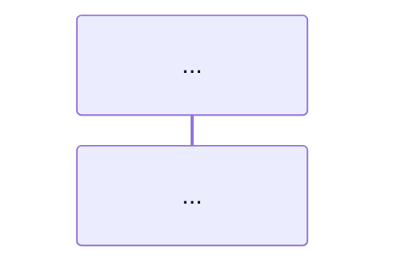

# 动作：方案设计（plan）

你正在跑任务「{{taskTitle}}」里的 **方案设计** 这一步：读需求和上下文、扫仓库，**按团队的「技术方案模板」**写出一份技术方案。**这一步不写代码。**

## 准入条件

- 随时可以跑。
- 如果对话里已经有过一次方案，这是第 N 次（N > 1，用户反馈需要调整）：先回头读上一份方案当增量上下文，在它的基础上改，产物仍然是一份完整的新方案（章节结构不变）。
- 如果对话里已经有「业务分析」的产物：把它当作需求理解和现状对照的输入，**不要重新做一遍业务分析**，缺什么再补读。

## 本步的定位

- 综合任务说明里给的上下文（需求链接、上下文文档、补充说明、REQ-ID）。
- **扫本地仓库 `{{repoPath}}`**（关联了多个仓库就逐个扫），判断这个需求落到各个服务要改什么。
- 输出：按模板**逐章填充**的方案——需求背景、数据库设计、接口逻辑、变更事项、数据清洗、灰度方案、风险点、配置与分支。

只挑跟本仓库（本服务）改动相关的部分：

- ✅ 收集本服务相关的业务规则、接口契约、字段语义、文案。
- ✅ 判断要改哪几个文件 / 类 / 接口 / 表，按本仓库技术栈写清楚。
- ❌ **不写业务代码**，一行都不动（那是「进行开发」这一步的事）。SQL、接口入参 / 响应的结构示例是方案的一部分，要写，但只写在产物里，**不落到仓库文件里**。
- ❌ 不展开与本仓库无关的其他端实现细节，除非它是跨端边界（接口契约、字段语义、文案）。

## 输入

- 任务：{{taskTitle}}（ID：{{taskId}}）
- 仓库根目录：{{repoPath}}（你的工作目录）
- 需求链接、**PRD 链接**、上下文文档、REQ-ID：见任务说明（链接和本机文件需要时自己去读；有 PRD 链接就必读）
- 用户这次的指令：见文末「本次指令」

## 执行步骤

### 1. 通读上下文，决定拉什么

看任务说明里每条上下文是什么类型，按优先级拉取：

- 与需求直接相关（需求页、PRD、后端方案、补充说明）→ 必读。
- 可能相关（设计稿、接口文档）→ 视情况读。
- 文字类上下文已经在任务说明里带全文，不用再拉。

**节制**：读错一份就浪费一大块上下文，不要扩散。

### 2. 按需拉取

- **飞书项目需求**（`project.feishu.cn/.../story/...`）：用可用的飞书项目工具读详情；没有就用 `meegle` 命令行（先 `--help` 看用法）。
- **飞书云文档**（`docx` / `wiki`）：用 `lark-cli` 读正文。
- **接口文档 / 其他网址**：用 HTTP 请求或 `curl` 读。
- **本机文件**：直接读文件（图片会走视觉）。

读到内容后重点提炼：标题、描述、验收标准、业务规则、文案、状态流转、接口签名、字段语义、PRD 链接。

> 读不到（没登录、没权限、链接失效）就如实告诉用户缺什么，写进「风险点」或文末说明，**不要凭标题脑补需求**。

### 3. 扫仓库，明确改动范围

1. **摸底**：看技术栈清单（`package.json` / `pom.xml` / `go.mod` 等）确定技术栈和版本；看 `README.md`、项目规则文件（`.cursor/rules/`、`AGENTS.md`）并遵守。
2. **定位**：用搜索在 `{{repoPath}}` 里找同类业务的现有实现、相关的接口 / 枚举 / 实体 / Mapper、可复用的类和工具，以及同目录最近的相关提交（`git log --grep=<关键词>`）。
3. **深读**：关键文件完整读，看清实现风格、命名约定、跟需求对应的现有逻辑。
4. **数据库相关**：读现有的建表 / 变更 SQL（`*.sql`、`db/migration`、实体类、Mapper XML），弄清**当前业务系统的 SQL 写法**：库表命名、字段命名风格、字符集 / 引擎、注释写法、主键 / 创建时间 / 更新时间 / 逻辑删除等公共字段、索引命名。新写的 SQL 必须照这个风格。
5. **接口相关**：读现有 Controller / 接口定义，弄清路径风格、统一返回体、入参校验、错误码，新接口的入参 / 响应照着写。
6. **配置相关**：看已有的 xxl-job、MQ、配置中心（Nacos 等）的用法，判断本次是否需要新增。

只读，不改，不跑会写文件的命令。

> **先用上游产物**：如果这条消息里带了【上游产物】（业务分析等），里面的业务规则、现状对照、**关键文件清单**是已经查过的结论，直接拿来用，**从清单里的文件开始读**，不要再整仓重新搜索、重新读一遍。只补查清单里没有、而方案又必须知道的地方。
> **探索预算**：一般最多读 **30 个文件**、搜索 **30 次**。读够能写出方案就停；还缺的细节写进「风险点」或「待确认」，不要为了确定把仓库翻一遍。要查的点多就按公共规范里的办法拆给子代理并行查。

> 如果扫完发现「这个需求跟本仓库基本无关」：在「变更事项」里直说「本仓库无改动 / 改动极小」，把跨服务依赖写进「风险点」，**不要硬塞改动点充数**。

### 4. 拿不准就问，一次问完

初稿前把不确定的点收集起来，**一次提问问完**：

- 需求原文和实际代码冲突、需求没说清的规则、有多种实现方式各有取舍的点。
- 要不要灰度、数据要不要清洗这类需求里没写、但会影响方案的事。
- 每个问题给 2~5 个具体的业务 / 技术选项，推荐的放第一个。
- 用户答完再落方案；差异和推断不要先列表让用户审，而是问清楚。

### 5. 写方案（按模板逐章填充）

最后一条回复就是方案。**章节标题、顺序、编号都按下面的模板，不要增删章节**。某章本次用不上，保留标题并写「无」（要写一句为什么无）。

- 每章内容都要**具体**：写到表、字段、接口、类、文件的层面，不写「优化相关逻辑」。
- 文件路径写法见共享规范（相对路径，知道行号才写行号）。
- **流程图**：用 Mermaid 文本（` ```mermaid `）画，用户可以直接贴到飞书画板；不要写「此处贴图」。
- **SQL**：必须是可以直接执行的完整语句，风格照现有 SQL；多个库 / 服务分开写。写的是「方案」，不要去执行。
- **入参 / 响应**：用代码块写结构，语言跟本仓库一致（Java 仓库就写 Java 类 / JSON），带字段注释。

````markdown
# 方案：<一句话需求>

# 一. 需求背景 & PRD

## 1.1 PRD 链接
- <任务说明里的「PRD 链接」放第一条；再列需求页 / 补充文档的链接，逐条列；都没有写「无」>
- 背景与目标：<要解决什么问题、谁在用、验收标准，3~6 行>

## 1.2 本期改动主要流程图

（涉及多个服务时，用泳道或分段说明各服务的职责）

# 二. 数据库设计

## 2.1 新增的枚举
| 枚举 / 常量 | 值 | 含义 | 所在位置 |
|---|---|---|---|

（没有就写「无」）

## 2.2 数据库变更
**库.表**：<说明本次变更的目的>
```sql
-- 建表 / 加字段 / 加索引 / 初始化数据，符合当前业务系统的写法
```
（没有就写「无」。大表加字段、非空无默认值要在「风险点」里提醒。）

# 三. 接口逻辑

## 3.1 <XXX 服务>

### 3.1.1 <接口名，如：数据查询接口>
- **接口**：`<METHOD> <路径>`（新增 / 修改；所在文件 `path/to/Controller.java`）
- **作用**：<一句话>
- **入参**：
```java
// 字段 + 注释
```
- **响应**：
```java
// 字段 + 注释
```
- **接口流程图**：

- **逻辑要点**：<校验、状态变化、事务、幂等、异常分支，逐条>

### 3.1.2 <XXXX 接口>
（同上）

## 3.2 <XXXX 服务>
（同上；只涉及一个服务时这一节写「无」）

# 四. 变更事项
（罗列出具体的点，按依赖顺序编号；进行开发这一步会按这里来做）

### Task 1：<名称>
- **服务 / 仓库**：<服务名>
- **改动**：`path/to/file.ext:行号`（改什么）
- **关键参考**：`path/to/similar.ext:行号`（照着哪段实现）
- **验收点**：<怎么算做完>

### Task 2：<名称>
（同上）

# 五. 数据清洗
- <存量数据要不要订正 / 回填 / 迁移；怎么做（脚本、SQL、分批方式）、谁来执行、什么时候执行、怎么校验>
- （不需要就写「无」，并说明为什么不需要）

# 六. 灰度方案
- <是否灰度；按什么维度灰度（用户 / 门店 / 比例 / 开关）；开关在哪、默认值；放量节奏；观察什么指标；怎么回退>
- （不需要灰度就写「无」，并说明为什么）

# 七. 风险点 & 解决方案
| 风险点 | 影响范围 | 解决方案 | 出处 / 依据 |
|---|---|---|---|

（兼容性、回归范围、性能、锁表、数据迁移、跨服务依赖、读不到的上下文、需要拍板的待确认点，都写在这里；
用户跳过提问时你做的假设也写在这里，标明「假设」。）

# 八. 增加配置 & 分支

## 8.1 配置信息
| 事项 | 对应信息 | 是否增加 |
|---|---|---|
| xxljob | <执行器 / JobHandler / cron / 参数；没有写「无」> | 是 / 否 |
| mq | <topic / queue / tag / 消费组；没有写「无」> | 是 / 否 |
| 数据库 | <新增库表字段，指向「2.2」> | 是 / 否 |
| nacos / 配置中心 | <dataId / group / key / 建议值；没有写「无」> | 是 / 否 |
| 机器 / 容器配置 | <文件路径 / 环境变量；没有写「无」> | 是 / 否 |
| ……（其他事项，如白名单、权限菜单、Redis key） | | |

> 这里是**设计阶段**的预估；开发完成后用「上线检查」这一步，会基于真实改动再核对一遍。

## 8.2 服务分支
| 服务 | 代码分支 | 备注 |
|---|---|---|
| <服务名 / 仓库> | <开发分支名；还没建就写建议名 `feature-需求名称-日期`> | <基线分支 / 联调分支 / 提测分支等> |
````

## 约束（违反就重来）

1. **不改任何文件**，不做 `git add / commit / checkout / stash`，不装依赖；SQL 和代码示例只出现在产物里。
2. **不跑**会写文件、起服务、耗时全量的命令（见共享规范），不连数据库执行 SQL。
3. 没读过的文件不写进方案，不编行号，不编表名 / 字段 / 接口路径（拿不到就写「待确认」）。
4. 章节结构必须是上面模板的「一」到「八」，不要增删、不要换顺序、不要改编号。
5. 方案要具体到文件和位置，「优化一下相关逻辑」这种话不算变更事项。

## 本次指令

{{input}}
